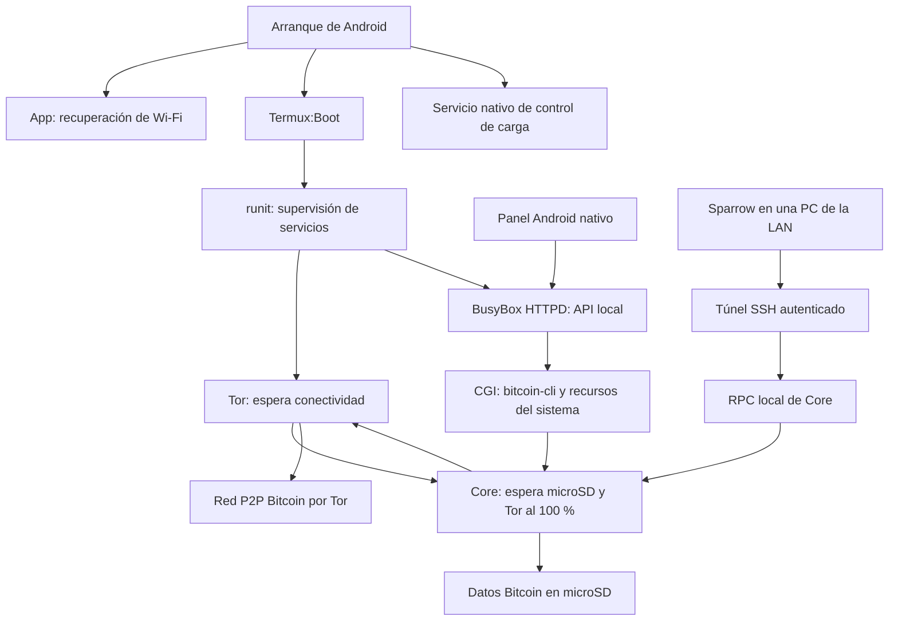

# LG G Pad V480 como nodo Bitcoin con Tor

Documentación de la transformación de una LG G Pad 8.0 V480 en un nodo Bitcoin podado, con conexiones por Tor, arranque automático y un panel Android nativo de bajo consumo.

El proyecto reúne recuperación de hardware, instalación de una ROM alternativa, configuración de servicios en Termux, desarrollo de una aplicación Java y ajustes para trabajar con menos de 1 GiB de RAM utilizable.

Se describen la configuración final, la evolución del desarrollo y los resultados de las pruebas realizadas.

## Objetivo y resultado

Se buscó reutilizar una tablet antigua para validar Bitcoin de forma independiente y consultar su estado desde una pantalla dedicada.

El trabajo dejó documentados estos resultados:

- Bitcoin Core en mainnet, con la sincronización inicial completada durante las pruebas.
- Validación de la cadena con poda de los archivos de bloques.
- Conexiones P2P salientes mediante Tor y publicación de un servicio onion P2P persistente.
- Datos grandes de Core en la microSD y software/configuración en almacenamiento interno.
- Inicio automático de Tor, Core, el servidor de la API y SSH después de reiniciar Android.
- Recuperación automática del Wi-Fi mediante una aplicación propia.
- Panel nativo en pantalla completa, con vistas vertical y horizontal.
- Inicio y parada del nodo desde una pantalla de mantenimiento.
- Control de carga de la batería entre 50 % y 70 %.
- Conexión de Sparrow al RPC local mediante un túnel SSH dentro de la LAN.
- Ajustes de memoria reversibles y acceso root de ADB deshabilitado al finalizar el mantenimiento.

Un nodo podado valida los bloques que descarga y luego elimina parte del historial almacenado. La poda reduce almacenamiento; no elimina el trabajo de validación inicial.

## Hardware y software utilizados

Las versiones siguientes son las registradas en esta experiencia, no una lista de las versiones más recientes.

| Componente | Características o versión registrada |
| --- | --- |
| Tablet | LG G Pad 8.0 V480, variante Wi-Fi, codename `e8wifi` |
| Arquitectura | ARMv7 de 32 bits, ABI `armeabi-v7a` |
| RAM | Aproximadamente 886 MiB visibles para Android |
| Pantalla | 800 × 1280 en vertical y 1280 × 800 en horizontal |
| microSD utilizada | Clase comercial de 32 GB, aproximadamente 30 GiB utilizables |
| Sistema inicial | Firmware V48020b, Android 5.0.2 |
| Firmware intermedio | KitKat V48010b |
| Recovery | TWRP 3.1.0-0 para V480 |
| Sistema instalado | LineageOS 14.1 no oficial, Android 7.1.1 |
| Kernel | Linux 3.4.0-Lineage+, ARMv7 |
| Termux | 0.118.3 |
| Termux:Boot | 0.8.1 |
| Bitcoin Core | 31.1, paquete ARM de Termux |
| Servicios auxiliares | Tor, OpenSSH, BusyBox HTTPD y runit mediante `termux-services` |
| Aplicación propia | Nodo Bitcoin; última fuente y APK conservados: versión 1.16 |

Se evaluó la alternativa de Linux nativo. Al no disponer de un port listo y comprobado para esta unidad, se eligió LineageOS con Termux para conservar el soporte Android del hardware.

## Arquitectura



La app obtiene los datos de una API en `127.0.0.1`. El CGI consulta Core dentro de Termux y lee sensores del sistema. El panel no recibe la cookie RPC ni la contraseña de Core.

| Servicio | Escucha en la tablet | Uso |
| --- | --- | --- |
| RPC de Bitcoin Core | `127.0.0.1:8332` | Consultas locales y acceso por túnel SSH |
| P2P de Bitcoin Core | `127.0.0.1:8333` | Destino del servicio onion P2P |
| API HTTP | `127.0.0.1:8080` | Panel local |
| SOCKS de Tor | `127.0.0.1:9050` | Conexiones salientes de Core |
| Control de Tor | `127.0.0.1:9051` | Comprobación del arranque de Tor mediante cookie |
| SSH de Termux | Puerto `8022` en la LAN | Administración autenticada y túneles locales |

`127.0.0.1` es loopback: los servicios ligados a esa dirección se acceden localmente dentro de la tablet. El estado final documentado conserva acceso administrativo por LAN y un onion exclusivamente P2P. El onion administrativo ensayado durante el trabajo fue desactivado.

## Cómo se realizó

### 1. Diagnóstico y respaldos

Antes de modificar el equipo se identificaron modelo, firmware, arquitectura, RAM, particiones y capacidad real de la tarjeta. La capacidad detectada de la microSD difería de la estimada inicialmente; se dimensionó el proyecto según el almacenamiento efectivamente disponible.

Se respaldaron el almacenamiento compartido, la microSD y 29 particiones del firmware original. Se comprobaron la integridad de los archivos comprimidos, la lectura completa de los TAR y los hashes de las imágenes. Un intento de `adb backup` produjo un archivo vacío y se descartó como respaldo válido.

### 2. Downgrade, root temporal y recovery

La ruta usada para esta V480 requirió volver desde Lollipop al firmware KitKat compatible con el procedimiento de instalación de LineageOS.

1. Se prepararon el controlador LG, LG Flash Tool 2014 y el firmware V48010b.
2. Se verificaron los archivos descargados mediante las sumas publicadas y hashes locales.
3. Se inició la tablet en Download Mode y se escribió el firmware KitKat. Este paso borró los datos de usuario.
4. Se habilitó nuevamente la depuración USB.
5. PurpleDrake Lite R03 permitió obtener el acceso necesario para respaldar particiones e instalar recovery.
6. Se respaldaron `boot` y `recovery` antes de reemplazar el recovery original.
7. Se instaló TWRP para V480, se leyó nuevamente la partición y se comparó su hash con la imagen prevista.
8. Se arrancó directamente a TWRP para evitar que Android restaurara el recovery original.

La identificación del modelo y del mapa de particiones fue parte del procedimiento. Las imágenes de V480 no se deben trasladar a V490, V500 u otras variantes con nombres parecidos. La guía histórica del mantenedor explica el requisito de KitKat y las diferencias entre modelos: [LineageOS para LG G Pad 8](https://just.pro.br/blog/lineage-gpad/).

### 3. Instalación de LineageOS y Termux

Desde TWRP se limpiaron las particiones necesarias, se instaló la compilación de LineageOS 14.1 para V480 y se verificó que el proceso terminara sin errores. El equipo inició Android 7.1.1 con kernel ARMv7.

Se instalaron Termux y Termux:Boot desde la misma procedencia, se abrieron una vez y se prepararon los permisos de almacenamiento y las excepciones de optimización de batería. Termux proporcionó el entorno de usuario Linux y los paquetes ARM de Bitcoin Core, Tor y las herramientas auxiliares.

Termux:Boot requiere abrirse inicialmente y ejecuta los scripts de `~/.termux/boot/`; también permite tomar un wake lock antes de iniciar servicios. Véanse [Termux 0.118.3](https://github.com/termux/termux-app/releases/tag/v0.118.3) y [Termux:Boot](https://github.com/termux/termux-boot).

### 4. Separación del almacenamiento

La tarjeta FAT32 estaba expuesta mediante FUSE. Se comprobó que Termux podía escribir y que LevelDB funcionaba en el directorio externo asignado a la aplicación por Android.

La distribución adoptada fue:

| Ubicación | Contenido |
| --- | --- |
| Almacenamiento interno | Android, app nativa, Termux, ejecutables, configuración, scripts y estado privado de Tor |
| microSD | Directorio de datos de Core: bloques, `chainstate`, archivos auxiliares, registros y cookie RPC |

Ejemplo genérico de la ruta de datos:

```text
/storage/SD_CARD_ID/Android/data/com.termux/files/bitcoin
```

`SD_CARD_ID` representa el identificador de la tarjeta de cada instalación. Las rutas deben adaptarse tanto en el arranque de Core como en los comandos auxiliares y en la API.

La poda se fijó en 3000 MiB para los archivos de bloques. Durante las pruebas, `chainstate` ocupaba aproximadamente 16 GiB adicionales. Por eso, una poda de unos 3 GiB no significa que todo el nodo ocupe ese espacio.

### 5. Configuración de Bitcoin Core

Se ajustó Core para aceptar y retransmitir transacciones, validar con recursos limitados y evitar índices opcionales.

| Parámetro final documentado | Valor | Motivo |
| --- | --- | --- |
| `prune` | `3000` | Acotar los archivos de bloques conservados |
| `dbcache` | `32` | Reducir el presupuesto de caché de base de datos |
| `maxmempool` | `20` | Limitar el presupuesto de la mempool en MB |
| `maxconnections` | `12` | Acotar las conexiones automáticas |
| `mempoolexpiry` | `336` | Caducidad de transacciones en horas |
| `persistmempool` | `0` | No guardar la mempool entre reinicios |
| `par` | `1` | Limitar los hilos de verificación de scripts |
| `rpcthreads` / `rpcworkqueue` | `2` / `8` | Acotar los recursos de atención RPC |
| `maxuploadtarget` | `500` | Objetivo de subida en MiB por período de 24 horas |
| `blocksonly` | `0` | Mantener recepción de transacciones sin confirmar |
| `txindex`, `blockfilterindex`, `coinstatsindex` | `0` | Evitar índices adicionales |

Se configuró una wallet de descriptores de solo observación para el uso con una wallet de hardware y Sparrow. Esta wallet permite consultar la actividad sin almacenar claves de firma, que permanecieron en el dispositivo de hardware.

La configuración local usó cookie RPC para los procesos de la tablet y autenticación RPC específica para Sparrow a través de SSH. Las credenciales se generan por instalación.

La evolución incluyó ensayos con más conexiones y una mempool de 64 MB. Después de que Android terminara Core por presión de memoria, se volvió a 20 MB y 12 conexiones. Posteriormente se redujo `dbcache` de 64 a 32 MiB mediante una parada y un arranque ordenados.

Estos presupuestos no fijan un límite total de RAM para Core. La documentación del proyecto Bitcoin explica los ajustes y sus intercambios entre memoria y rendimiento: [Reducir uso de memoria](https://raw.githubusercontent.com/bitcoin/bitcoin/v31.1/doc/reduce-memory.md).

### 6. Tor y política de red

Core se configuró para utilizar el SOCKS local de Tor en sus conexiones salientes. Tor publicó un servicio onion v3 persistente que dirige el puerto P2P a la escucha local de Core.

Se deshabilitaron el descubrimiento de dirección pública y las aperturas automáticas mediante UPnP/NAT-PMP. El servicio onion se administró explícitamente desde Tor, con `listenonion=0` en Core para evitar una segunda gestión automática de ese servicio.

El script de arranque consultó el ControlPort autenticado mediante cookie y esperó que Tor informara un progreso del 100 % antes de ejecutar Core. Las claves y el hostname onion permanecieron en el espacio privado de Termux.

Se comprobaron el proxy declarado por Core y las escuchas locales. Los registros iniciales no incluyeron una prueba externa completa del onion P2P; en comprobaciones posteriores se observaron pares entrantes. La política configurada sigue la documentación de [Bitcoin Core con Tor](https://github.com/bitcoin/bitcoin/blob/v31.1/doc/tor.md).

### 7. Supervisión y arranque automático

`termux-services` y runit administraron cuatro servicios: `tor`, `bitcoind`, `busybox-httpd` y `sshd`.

El script de Termux:Boot tomó un wake lock, inició la supervisión y levantó los servicios. Las dependencias de arranque se trataron explícitamente:

1. Esperar una conexión Wi-Fi utilizable.
2. Esperar que la microSD estuviera montada y que el directorio de datos fuera escribible.
3. Esperar la cookie del ControlPort de Tor.
4. Esperar el bootstrap completo de Tor y la identidad onion disponible.
5. Iniciar Core y permitir que cargara y verificara su base de datos.

Se crearon comandos auxiliares `node-start`, `node-stop`, `node-status` y `node-ui`, junto con registros rotados de los servicios. La interfaz de mantenimiento usó esos comandos para iniciar y detener el nodo sin abrir una terminal visible.

### 8. Corrección de la reconexión Wi-Fi

La ROM conservaba la red guardada, pero después de reiniciar podía quedar desconectada hasta seleccionar manualmente la conexión.

Se comprobó que el perfil estaba habilitado y que la selección de red y la reconexión funcionaban. Un intento mediante scripts de inicio del sistema fue bloqueado por SELinux. La solución implementada fue una app que utiliza las APIs Wi-Fi de Android.

El servicio de la app:

- Se inicia al recibir el evento de arranque y vuelve a iniciarse tras actualizar el paquete.
- Mantiene un solo hilo de reconexión.
- Comprueba la conexión cada 60 segundos cuando está conectada.
- Si pierde conexión, habilita el Wi-Fi, selecciona la red guardada de mayor prioridad y reintenta cada 10 segundos.
- Usa un wake lock temporal durante la recuperación.

La app reutiliza las redes configuradas en Android. No contiene una contraseña Wi-Fi embebida ni la solicita al usuario.

### 9. Desarrollo y evolución del panel

La primera implementación utilizó un panel HTML servido por BusyBox HTTPD y mostrado mediante WebView. La página consultaba una API JSON para actualizar indicadores sin recargarse.

Para reducir memoria se desarrolló un panel Java nativo, dibujado en una sola vista Android. Después se retiraron la WebView, su actividad y la ruta HTML; la API JSON local se conservó.

| Etapa | Cambio principal |
| --- | --- |
| App inicial y revisiones 1.3–1.5 | Reconexión Wi-Fi, controles de servicios y prevención de pantallas duplicadas |
| 1.6 | Panel nativo como interfaz principal; panel web alternativo durante la transición |
| 1.7 | Retiro del panel web, reloj independiente, renderizado por software y corrección de timers |
| 1.8 | Panel seleccionado como pantalla de inicio de Android |
| 1.9–1.16 | Ajustes de distribución vertical/horizontal, alineaciones, barras y presentación de indicadores |

La última fuente conservada muestra estado de Core y Tor, bloques y cabeceras, sincronización, antigüedad del último bloque, pares entrantes/salientes, mempool, actividad del servicio, microSD, memoria, batería, temperatura y conexiones SSH. La vista Detalles agrega información técnica y la identidad onion; el informe completo se consulta bajo demanda.

Se cuidó el ciclo de vida de la interfaz:

- Un único worker realiza las consultas; espera unos 10 segundos después de cada respuesta antes de iniciar la siguiente.
- Al ocultarse el panel se cancelan los timers y se desconecta la petición pendiente.
- Al destruir la actividad se cierra el executor.
- `singleTask` y las banderas de navegación evitan acumular instancias.
- El reloj se actualiza al cambiar el minuto y continúa funcionando si falla HTTP.
- Detalles es un estado de la misma vista y no abre otro panel.
- Inicio vuelve al resumen; Atrás cierra Detalles y conserva el panel principal.

La pantalla de mantenimiento consulta normalmente cada 10 segundos y cada 3 segundos durante una transición. Bloquea acciones incompatibles con el estado del servicio y evita duplicar ciclos de consulta al pulsar los botones.

La app actual declara permiso `INTERNET` porque Android lo requiere incluso para HTTP de loopback. Los destinos HTTP encontrados en su código apuntan a `127.0.0.1`.

Los botones utilizan `com.termux.RUN_COMMAND` para invocar los comandos de inicio y parada. Se habilitó `allow-external-apps=true` y se concedió el permiso de ejecución a la app, según la [API RUN_COMMAND de Termux](https://github.com/termux/termux-app/wiki/RUN_COMMAND-Intent).

### 10. Optimización de la API

El CGI consulta `getblockchaininfo`, `getnetworkinfo` y `getmempoolinfo` de forma secuencial, con timeouts, para acotar los procesos simultáneos y sus picos de memoria.

La optimización se realizó en dos etapas:

1. Se reemplazaron múltiples pipelines por campo por una sola pasada de `awk` sobre las respuestas RPC.
2. Se usaron operaciones internas del shell para leer batería, memoria, Wi-Fi y tiempo de actividad, interpretar estados y emitir el JSON habitual.

Se conservó un escape específico para texto con Unicode, comillas, barras invertidas y caracteres de control. Se corrigió un problema de manejo de UTF-8 en dash/bionic antes de instalar la revisión. El parámetro de detalle se comprobó como `detail=1` exacto, evitando confundirlo con `detail=10`.

La API distingue Core activo, iniciando y detenido. El panel espera datos RPC durante el arranque en lugar de presentar los valores de reemplazo como un estado definitivo de la cadena.

### 11. Android dedicado y ajustes de memoria

La presión de memoria llevó a reducir procesos secundarios y a dedicar la tablet al panel.

Se deshabilitaron aplicaciones accesorias para el usuario de Android sin borrar sus datos. Posteriormente se deshabilitaron Trebuchet y el teclado LatinIME, se seleccionó el panel como HOME y se retiró el bloqueo de pantalla para que el panel apareciera tras arrancar.

Se activó `ro.config.low_ram=true` conservando propietario, permisos y contexto del archivo de configuración. AudioFX seguía iniciándose como proceso persistente aun deshabilitado; se respaldaron su APK y sus datos y se movió fuera del directorio que Android escanea como aplicaciones del sistema.

Se conservaron mecanismos para restaurar escritorio, teclado, perfil de RAM y AudioFX. Los cambios que necesitaron root se realizaron durante mantenimiento temporal y después se deshabilitó nuevamente el acceso root de ADB.

El kernel tenía soporte de zram, pero la configuración final no activó swap ni zram. Tampoco se modificaron los umbrales del eliminador de procesos por baja memoria. El perfil low-ram fue comprobado, aunque no se realizó un ensayo aislado que permita atribuirle una cantidad concreta de RAM ahorrada.

### 12. Control de carga de batería

Se desarrolló un controlador en C que lee la capacidad de batería y modifica `charging_enabled` mediante sysfs.

| Condición | Acción |
| --- | --- |
| Batería igual o superior al 70 % | Deshabilitar la carga |
| Batería igual o inferior al 50 % | Habilitar la carga |
| Entre ambos umbrales | Mantener el estado anterior |
| Intervalo de revisión | 60 segundos |
| Terminación normal del controlador | Volver a habilitar la carga |

La histéresis evita alternar continuamente la carga alrededor de un solo umbral. El binario ARM se instaló como servicio de `init`.

Los intentos iniciales encontraron restricciones SELinux. La instalación final documentada ejecutó el controlador en un dominio con permiso sobre los archivos de batería, sin desactivar SELinux. Se comprobó el cambio de estado de carga, el servicio activo después del reinicio y el acceso root de ADB nuevamente deshabilitado.

En este hardware, detener la carga hace que la tablet consuma batería aunque siga conectada al cargador. No se comprobó un modo que alimente el equipo omitiendo la batería.

### 13. SSH y conexión de Sparrow

Se configuró OpenSSH en Termux para administrar la tablet desde la LAN y transportar el RPC local de Core. Se restringió la configuración para impedir acceso root, reenvío de agente, X11 y redirecciones remotas; los forwards locales quedaron limitados a RPC y panel.

En Windows se prepararon dos modalidades: un lanzador portátil que pide la contraseña en cada conexión y una configuración por cuenta que autoriza una clave SSH propia de esa PC. También se conservaron scripts para configurar y abrir los túneles.

Ejemplo genérico equivalente para una terminal con OpenSSH:

```sh
ssh -p 8022 -N -T -L 127.0.0.1:8332:127.0.0.1:8332 TERMUX_USER@TABLET_IP
```

`TERMUX_USER` y `TABLET_IP` son marcadores que cada instalación debe reemplazar. Antes del primer acceso se verifica la huella de su propio servidor SSH por un medio local confiable.

Con el túnel abierto, Sparrow se configura para conectarse a Bitcoin Core en `127.0.0.1:8332` de la PC, usando credenciales RPC propias. La contraseña RPC y la contraseña SSH cumplen funciones diferentes. Si otra sesión ya utiliza ese puerto en la misma PC, se elige un puerto local alternativo.

## Compilación y componentes desarrollados

El desarrollo se organizó en los siguientes componentes:

| Componente | Responsabilidad |
| --- | --- |
| `BootReceiver.java` | Recibir el arranque e iniciar la vigilancia Wi-Fi |
| `WifiReconnectService.java` | Mantener un único ciclo de comprobación y reconexión |
| `MainActivity.java` | Pantalla de mantenimiento y órdenes a Termux |
| `NativePanelActivity.java` | Dibujo, navegación y consultas del panel |
| `AndroidManifest.xml` | Permisos, actividades, servicio y función de pantalla HOME |
| `api.cgi` | Estado JSON local y consulta técnica bajo demanda |
| `charge-control.c` / `charge-control.rc` | Control de batería y servicio de Android |
| Scripts de ajuste y restauración | Caché de Core, perfil low-ram y recuperación del escritorio |
| Scripts de acceso | Preparación SSH y túneles para Sparrow |

La app se compiló en Windows con JDK, plataforma Android SDK 36 y Build Tools 36.1.0. El proceso conservado utiliza `aapt2` para recursos, `javac` con nivel Java 8, `d8` para DEX, `zipalign` y `apksigner`. El manifiesto fija API mínima 24 y target 25.

El script genera el APK 1.16, verifica su firma y calcula SHA-256. La firma de desarrollo se obtiene de una keystore local. Para actualizar sin desinstalar se requiere una firma compatible con el APK ya instalado.

El controlador de carga se compiló con `zig cc`, objetivo `arm-linux-musleabi`, optimización de tamaño y enlace estático PIE. Su instalación y los permisos SELinux deben adaptarse al dispositivo; compilar el binario no configura por sí solo el servicio.

El icono naranja de Bitcoin se convirtió en un recurso vectorial Android local. Su referencia es [Bitcoin-clean.svg, publicado bajo CC0](https://commons.wikimedia.org/wiki/File:Bitcoin-clean.svg).

## Pruebas realizadas y resultados observados

Las verificaciones históricas incluyeron:

- Integridad de respaldos, imágenes de firmware y lectura posterior del recovery.
- Compilación y verificación de firma de los APK.
- Arranque automático sin intervención en pantalla y con root de ADB deshabilitado.
- Recuperación real después de deshabilitar Wi-Fi desde los ajustes de Android.
- Bootstrap completo de Tor, configuración de proxy y escuchas locales.
- Sincronización de Core: `initialblockdownload=false`, bloques iguales a cabeceras y avance posterior de la cadena.
- Inicio y parada desde la app, y cierre ordenado de Core durante mantenimiento.
- Aperturas repetidas y ciclos de navegación conservando un solo panel y worker.
- Recuperación de la interfaz al interrumpir y restaurar únicamente HTTP, manteniendo Core y Tor activos.
- Continuidad del reloj mientras la API estaba inaccesible.
- Comparación de claves, tipos y valores estables del JSON antes y después de optimizarlo.
- Casos de timeout, error de red, respuesta HTTP de error, JSON inválido, Unicode y RPC inaccesible simulado.
- Estado del control de carga después de reiniciar.
- Mediciones de procesos, memoria y registros de Android con ADB.

| Medición registrada | Antes | Después |
| --- | --- | --- |
| Primera optimización de API, mediana de cinco comparaciones | 1,4238 s | 0,9837 s |
| Segunda optimización de API, mediana de cinco comparaciones | 0,8437 s | 0,4330 s |
| Panel con WebView frente a primer panel nativo, muestras de PSS | Aproximadamente 57–60 MiB | Aproximadamente 29–37 MiB |
| Panel tras retirar WebView y ajustar su ciclo de vida | Muestra previa de 41,5 MiB | Aproximadamente 9–12 MiB |
| App en las pruebas de Android dedicado | — | Aproximadamente 7–11 MiB |

Los tiempos de API incluyen ADB; cada fila compara muestras de su propia etapa. No son una medición directa de CPU. Las cifras de PSS varían con la carga y la contabilidad de memoria compartida. No se demostró una reducción equivalente de toda la RAM de Core, ni un límite fijo de consumo, ni estabilidad indefinida.

## Uso diario y mantenimiento

Después de un arranque normal, el sistema recupera Wi-Fi, inicia servicios y muestra el panel. Core puede tardar en cargar el índice y verificar bloques desde la microSD; mientras el registro avance, conviene esperar a que termine esa etapa.

El panel distingue nodo activo, sincronizando, Core iniciando, esperando Tor, sin conexión, Core detenido y error de almacenamiento. La tarjeta Memoria representa recursos de toda la tablet. El contador SSH representa conexiones administrativas, no pares Bitcoin.

Para apagar de forma ordenada:

1. Abrir la pantalla de mantenimiento o acceder por SSH.
2. Ejecutar la acción de detener el nodo.
3. Esperar la finalización de Core; durante mantenimiento técnico, comprobar `Shutdown done` en el registro.
4. Apagar Android.

La microSD debe permanecer insertada mientras Core está activo. Después de un corte de Wi-Fi, Tor y Core pueden recuperar sus conexiones y continuar desde el estado válido almacenado.

Se mantuvo la pantalla encendida mientras el equipo estaba conectado y se amplió el timeout cuando estaba desconectado. El botón físico sigue permitiendo apagar la pantalla. Esos ajustes, el escritorio dedicado y el teclado deshabilitado son decisiones de esta instalación y tienen mecanismos de restauración.

## Cómo reproducir la experiencia

La reproducción requiere adaptar firmware, permisos y rutas al equipo propio. Las versiones y los procedimientos corresponden a la instalación descrita.

1. Identificar exactamente el dispositivo y verificar el soporte de ROM/recovery.
2. Respaldar datos y particiones antes de modificar firmware y comprobar que los respaldos sean legibles.
3. Instalar un Android compatible con Termux, siguiendo el procedimiento específico del modelo.
4. Instalar Termux y Termux:Boot compatibles entre sí, abrirlos y preparar permisos y batería.
5. Instalar los paquetes necesarios. El comando usado como base fue:

   ```sh
   pkg update
   pkg install bitcoin tor termux-services busybox runit openssh capnproto libsqlite
   ```

6. Identificar la microSD y comprobar escritura y funcionamiento del almacenamiento de Core.
7. Crear configuración propia para Core y Tor, con presupuestos acordes a la RAM y credenciales nuevas.
8. Preparar supervisión, dependencias de arranque, registros y comandos de parada ordenada.
9. Adaptar y compilar la app y el CGI, si se dispone de sus fuentes, y habilitar la integración autorizada con Termux.
10. Configurar el panel como HOME y aplicar ajustes de memoria solo cuando el equipo y la ROM los admitan.
11. Adaptar el controlador de carga únicamente si existen los nodos sysfs y permisos necesarios.
12. Probar reinicio, reconexión, cierre ordenado y recepción de nuevos bloques; esperar a que termine la sincronización inicial.

Las APIs de Wi-Fi y ejecución en segundo plano usadas por esta app están orientadas a Android 7. No se comprobó su funcionamiento sin modificaciones en versiones modernas de Android.

## Límites conocidos

- El parche de seguridad del sistema instalado corresponde a enero de 2017. La experiencia se orientó a un equipo dedicado; la configuración de red no actualiza la seguridad de la ROM.
- `dbcache=32` reduce un presupuesto concreto de caché y puede aumentar las lecturas de microSD. No limita la RAM total de Core.
- La poda no acota `chainstate` ni todos los archivos auxiliares. El espacio libre debe vigilarse con el tiempo.
- Un nodo podado no conserva ni puede servir todos los bloques históricos. Recuperaciones o rescaneos que requieran bloques eliminados pueden necesitar otra descarga.
- La microSD y el kernel antiguo condicionan los tiempos de sincronización, arranque y acceso a datos.
- Los cortes bruscos repetidos pueden dañar archivos o bases de datos; la recuperación puede requerir reindexación.
- La conexión mediante Tor y la llegada de pares entrantes dependen de la red y no garantizan un número fijo de conexiones.
- Los ajustes de batería y SELinux son específicos de este hardware y de esta ROM.
